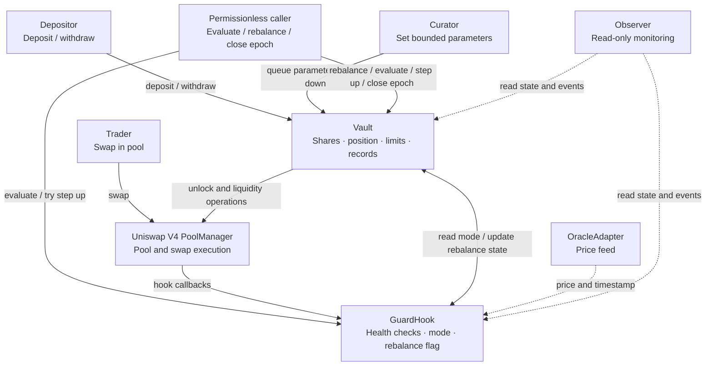
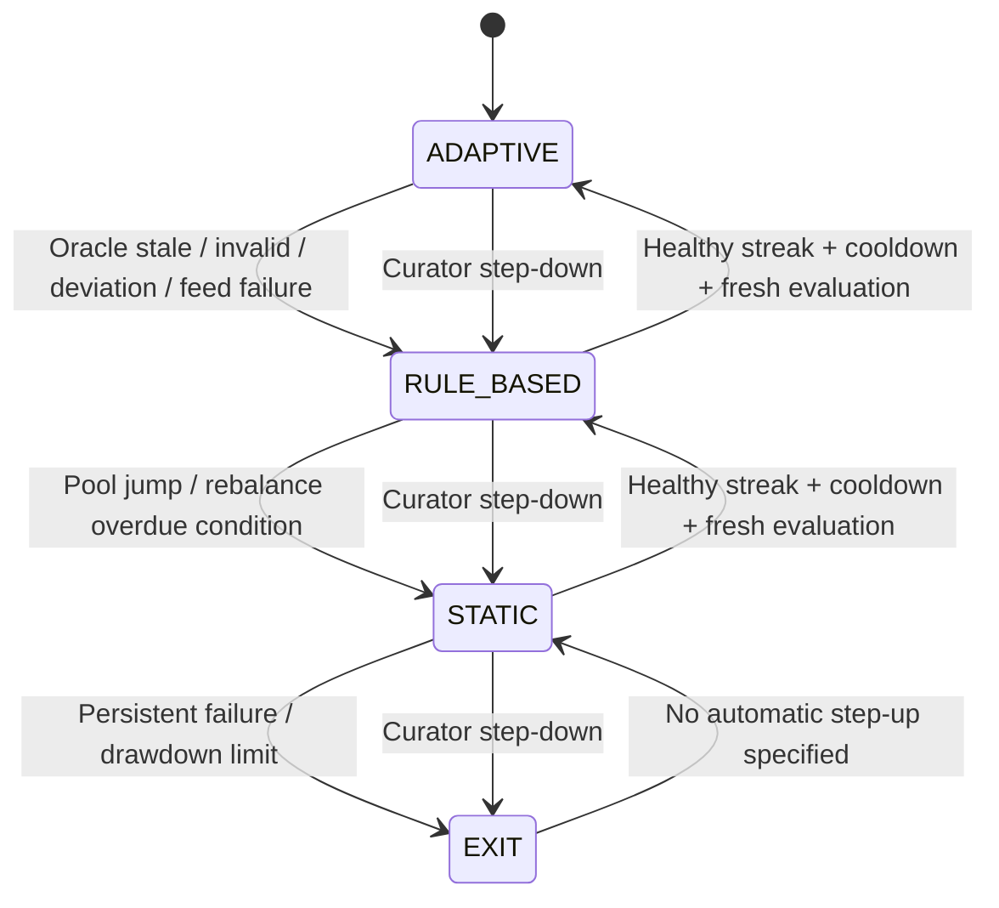

# Automated Liquidity Management System — Architecture

> **Document status:** Draft / design baseline  
> **Version:** 0.1  
> **Scope:** Single-pool, Uniswap V4-based automated liquidity management system  
> **Primary contracts:** `GuardHook`, `Vault`  
> **External protocol:** Uniswap V4 `PoolManager`

---

## 1. Purpose and scope

This document describes the proposed architecture, high-level design (HLD), and low-level design (LLD) for an automated liquidity management system built around a Uniswap V4 pool.

The system manages a liquidity position on behalf of vault depositors. It monitors pool and oracle conditions, changes its operating mode when conditions deteriorate, and allows permissionless callers to trigger bounded rebalances when the system is healthy enough to do so.

The design separates responsibilities:

- **`GuardHook` is the risk and mode-control layer.** It evaluates pool/oracle health, maintains the operating mode, records reasons for mode changes, and exposes whether a rebalance is needed.
- **`Vault` is the accounting and position-management layer.** It accounts for depositor shares and assets, owns/manages the liquidity position, enforces curator bounds, executes rebalances, and records epochs.
- **Uniswap V4 `PoolManager` is the pool execution layer.** It processes swaps and liquidity operations and invokes the configured hook callbacks.
- **`OracleAdapter` is the external price-data boundary.** It normalizes access to a price feed and exposes the price and update timestamp.
- **`Observer` is a read-only consumer.** It reads the hook/vault state and events for monitoring, reporting, or an external interface. It does not control funds or mutate protocol state.

### 1.1 Goals

1. Manage one configured Uniswap V4 pool and one vault-owned liquidity strategy.
2. Keep depositor accounting separate from pool execution and risk evaluation.
3. Support four operating modes: `ADAPTIVE`, `RULE_BASED`, `STATIC`, and `EXIT`.
4. Degrade the strategy when oracle or pool conditions become unreliable.
5. Keep withdrawals available at the protocol level in every operating mode, without requiring an oracle-priced swap.
6. Bound curator configuration and rebalance execution.
7. Record mode changes, rebalances, deposits, withdrawals, and periodic performance snapshots.
8. Make the main risk controls and accounting properties testable as invariants.

### 1.2 Non-goals and current boundaries

The current baseline does not specify:

- Multi-pool or multi-chain management.
- Multiple vaults sharing one hook.
- Fee-on-transfer, rebasing, or otherwise non-standard ERC-20 support.
- A guaranteed execution price or MEV-free rebalancing.
- A production oracle provider or lending protocol integration.
- A production-ready benchmark methodology.
- An audited or compile-verified implementation.

The baseline assumes standard ERC-20 tokens with no transfer fees. It also assumes a single pool and a dual-token vault share model. The example pair in the design notes is USDC/USDT, but the final token pair and pool configuration remain to be confirmed.

---

## 2. Architecture at a glance

### 2.1 Logical component diagram



The diagram is logical rather than a call-trace guarantee. Exact Uniswap V4 callback signatures, permission flags, unlock flow, and state-library APIs must be checked against the specific v4-core / v4-template version selected for implementation.

### 2.2 Architectural style

The system uses an on-chain, modular smart-contract architecture:

- **Separation of concerns:** risk evaluation is in the hook; share accounting and position execution are in the vault.
- **Callback-driven observation:** pool swaps cause the hook to receive configured callbacks.
- **Permissionless operations:** keepers or any external caller can trigger eligible maintenance operations; callers do not choose arbitrary target ranges or swap amounts.
- **Fail-degraded strategy:** unhealthy inputs reduce available strategy functionality instead of authorizing more aggressive execution.
- **Read-only observability:** monitoring clients consume state and events without being trusted to make protocol decisions.

### 2.3 Trust boundaries

| Boundary | Trust assumption | Required treatment |
|---|---|---|
| Oracle feed | May be stale, unavailable, invalid, or manipulated | Validate timestamp, positive price, and deviation; handle failed calls |
| Pool spot price | Can be manipulated within a block | Bound price/tick movement and cross-check against oracle in `ADAPTIVE` mode |
| Curator | Authorized but not trusted with unrestricted control | Enforce immutable bounds and parameter timelock; no custody permissions |
| Rebalance caller | Fully untrusted | Caller supplies no target range or swap instructions; vault computes them |
| ERC-20 tokens | Standard token behavior is assumed | Use safe transfer handling; explicitly reject unsupported token behavior in deployment configuration |
| Observer / frontend | Read-only and potentially stale | Never use observer output as an authorization or execution input |
| PoolManager callbacks | Protocol-controlled but version-specific | Validate callback context and configure only required hook permissions |

---

# Part I — High-Level Design (HLD)

## 3. Actors and permissions

| Actor | Responsibilities | Restrictions |
|---|---|---|
| Depositor | Deposits both pool assets and withdraws vault assets | Cannot change strategy parameters or mode |
| Curator | Queues bounded parameter changes and may step the mode down | Cannot withdraw vault funds, step the mode up, or exceed configured bounds |
| Permissionless caller / keeper | Calls `rebalance()`, `evaluate()`, `tryStepUp()`, and `closeEpoch()` when their preconditions are met | Cannot set the target range, choose arbitrary swap amounts, or change parameters |
| Trader | Swaps through the configured pool | Does not receive privileged access to vault accounting |
| Observer | Reads state, labels, and emitted records | Cannot mutate protocol state |

The curator is a configuration role, not a fund custodian. The design should not give the curator a general token-transfer or arbitrary-call function.

## 4. Component responsibilities

### 4.1 GuardHook

**Owns:**

- Current operating mode.
- Health-check parameters or their authoritative configuration reference.
- Last observed tick and last check block.
- Last mode-change timestamp and reason.
- Healthy streak and step-down counter.
- `needsRebalance` status.

**Responsibilities:**

1. Receive configured Uniswap V4 callbacks.
2. Read the relevant pool state, including the current tick.
3. Evaluate inexpensive health conditions during swap callbacks.
4. Step the strategy down when a defined failure condition is detected.
5. Mark the vault as needing a rebalance when the position is near a configured range edge.
6. Expose read methods such as `mode()` and the current health/label information.
7. Allow permissionless full evaluation and guarded step-up attempts.

The hook is not responsible for calculating depositor shares or transferring depositor assets.

### 4.2 Vault

**Owns:**

- Depositor share accounting.
- Current liquidity position and tick range.
- Idle token balances tracked for accounting.
- Curator address, parameter bounds, and queued parameter changes.
- Rebalance interval and last-rebalance record.
- Epoch records and benchmark snapshots.

**Responsibilities:**

1. Accept deposits only in `ADAPTIVE` and `RULE_BASED` modes.
2. Calculate shares from the vault's accounted assets and mint them to depositors.
3. Permit in-kind withdrawals in every mode, subject to the underlying PoolManager and token operations being available.
4. Execute liquidity removal, optional inventory rebalancing swap, and liquidity addition through the PoolManager unlock flow.
5. Enforce range, movement, swap-size, and timing limits.
6. Apply curator parameter changes only after bounds and timelock checks.
7. Record epochs and benchmark values.
8. Pay a rebalance caller credit only from collected fees and within a cap.

### 4.3 Uniswap V4 PoolManager

The PoolManager is an external protocol component. It owns pool execution and invokes the hook callbacks configured for the pool.

The vault interacts with it through the version-specific unlock/callback mechanism to modify liquidity and perform any strategy swap. The vault must settle and take the relevant token deltas correctly within the PoolManager's accounting model.

### 4.4 OracleAdapter

The adapter exposes a normalized interface for reading a price and its update time. It isolates feed-specific details from the hook.

The adapter is not itself a source of trust. The hook must validate the returned data and handle a failed read. A mock implementation is used in unit tests; a real feed adapter is selected for the target network.

### 4.5 Observer

The observer is an off-chain or UI-facing read-only participant. It can read:

- Current mode and last reason.
- Health parameters and last observed tick.
- Vault position, idle balances, and share-related views.
- Epoch records and emitted events.

The observer must not be able to alter strategy state. Its displayed information should be treated as a view of on-chain state, not as an independent source of truth.

## 5. Operating modes and state machine

### 5.1 Modes

| Mode | Rebalance | Deposits | Withdrawals | Strategy inputs |
|---|---|---|---|---|
| `ADAPTIVE` | Allowed after full health validation | Allowed | Allowed | Validated oracle and pool state |
| `RULE_BASED` | Allowed with pool-only rules and tightly capped movement | Allowed | Allowed | Pool state; bounded movement |
| `STATIC` | Disabled | Disabled | Allowed | No active strategy input required |
| `EXIT` | Normal rebalance disabled; unwind is available | Disabled | Allowed | No oracle required for in-kind exit |

`EXIT` is an unwind/withdrawal state, not a promise that assets can always be transferred under every possible token or PoolManager failure.

### 5.2 Step-down transitions



The normal automatic step-down path moves down at least one rung. A severe failure may be configured to move down more than one rung, but the severity mapping must be explicit and covered by tests.

### 5.3 Step-up rules

A step-up:

- Is permissionless to request.
- Moves only one rung at a time.
- Requires a healthy streak of the configured length.
- Requires the configured cooldown to have elapsed.
- Requires a fresh full health evaluation to pass.
- Must not be callable by the curator as a privileged override.

No automatic transition out of `EXIT` is defined in the current baseline. If recovery from `EXIT` is required, it must be designed as a separate governance or migration process rather than assumed.

### 5.4 Health conditions

The design baseline identifies these conditions:

| Condition | Meaning | Expected response |
|---|---|---|
| `POOL_JUMP` | Tick movement exceeds `maxJumpTicks` | Step down according to configured severity |
| `ORACLE_FAIL` | Oracle adapter read reverts or cannot be decoded | Step down from `ADAPTIVE` |
| `ORACLE_STALE` | `block.timestamp - updatedAt` exceeds `maxOracleAge` | Step down from `ADAPTIVE` |
| `ORACLE_INVALID` | Returned price is zero or negative | Step down from `ADAPTIVE` |
| `DEVIATION` | Pool-derived price differs from oracle beyond `maxDeviationBps` | Step down from `ADAPTIVE` |
| `NO_REBALANCE` | Rebalance is overdue and the position is out of range | Step down according to configured policy |
| Drawdown limit | Vault drawdown exceeds configured threshold | May force `EXIT`; exact threshold/configuration remains to be specified |

The exact order of checks, price-decimal normalization, tick-to-price conversion, and severity mapping must be fixed in implementation specifications.

## 6. Main system flows

### 6.1 Deposit flow

1. Depositor calls `Vault.deposit(amount0, amount1, receiver)`.
2. Vault checks that the current mode is `ADAPTIVE` or `RULE_BASED`.
3. Vault calculates the current accounted holdings: position token amounts at the current pool price plus internally accounted idle balances.
4. Vault calculates the proportional share entitlement.
5. Vault accepts only the matching token amounts and refunds excess amounts, or uses an explicitly documented alternative deposit interface.
6. Vault adds the accepted assets to the strategy and mints shares.
7. Vault emits `Deposited`.

The baseline share calculation is proportional and does not require an oracle price. Exact rounding, first-deposit handling, token ordering, and refund behavior must be specified in the LLD and tested.

### 6.2 Swap and health-monitoring flow

1. Trader submits a swap to the PoolManager.
2. PoolManager executes the swap and invokes the configured hook callbacks.
3. `GuardHook.afterSwap` reads the pool tick and performs the bounded, inexpensive health checks selected for swap-time evaluation.
4. If a failure is detected, the hook records the reason and steps the mode down.
5. If the position is near a range edge, the hook sets `needsRebalance`.
6. Hook returns the required callback selector and return data.

**Availability requirement:** a hook callback failure can cause the originating swap to revert. Therefore, the design target is for `afterSwap` to avoid avoidable reverts: keep logic bounded, avoid unnecessary external calls, handle oracle failures, and do not perform complex vault execution in the callback. This is an engineering objective, not an unconditional guarantee that the callback can never revert.

### 6.3 Rebalance flow

1. Any caller invokes `Vault.rebalance()`.
2. Vault checks the current mode is `ADAPTIVE` or `RULE_BASED`.
3. Vault checks the minimum rebalance interval.
4. Vault runs the full health evaluation. If unhealthy, it causes or observes the appropriate step-down and does not proceed with the rebalance.
5. Vault computes a target range centered around the current tick, aligned to pool tick spacing.
6. In `RULE_BASED`, vault enforces the maximum allowed movement from the previous range center.
7. Vault enters the PoolManager unlock flow.
8. Vault removes the current liquidity position and accounts for returned tokens and collected fees.
9. Vault calculates the target token ratio for the new range.
10. If required, vault swaps a bounded portion of surplus inventory, subject to price and size limits.
11. Vault adds liquidity at the new range; any unused amounts remain idle and are included in internal accounting.
12. Vault pays the caller credit from collected fees only, subject to the configured cap.
13. Vault updates `lastRebalance`, clears `needsRebalance`, and emits `Rebalanced`.

**MEV note:** the inventory-conversion swap can be front-run or sandwiched. A price limit, maximum swap size, and oracle validation reduce exposure but do not eliminate MEV. The rebalance swap policy is a pre-implementation decision and must be stress-tested.

### 6.4 Withdraw flow

1. Depositor calls `Vault.withdraw(shares, receiver)` or the chosen equivalent.
2. Vault burns the caller's shares.
3. Vault calculates the proportional share of liquidity and idle token balances.
4. Vault removes the corresponding liquidity through the PoolManager if necessary.
5. Vault transfers both assets in kind to the receiver.
6. Vault emits `Withdrawn`.

Withdrawals are not gated by the operating mode and do not require an oracle-priced swap. The implementation should not advertise an absolute guarantee against external token, PoolManager, or network failures.

### 6.5 Exit/unwind flow

In `EXIT`, normal deposits and rebalances are disabled. A permissionless `unwind()` operation can remove all remaining pool liquidity and move the position into idle token balances. Depositors can then withdraw their pro-rata in-kind assets.

The exact authorization, repeat-call behavior, partial-failure behavior, and interaction with outstanding fees must be specified before implementation.

### 6.6 Epoch-close flow

1. Caller invokes `closeEpoch()` after the minimum epoch interval.
2. Vault calculates the share-price metric using the documented valuation method.
3. Vault reads configured benchmark values.
4. External benchmark reads are isolated with failure handling; unavailable values are marked unavailable rather than silently treated as zero.
5. Vault stores the epoch record in a fixed-size ring buffer.
6. Vault emits `EpochClosed`.

### 6.7 Parameter update flow

1. Curator queues a new parameter set.
2. Vault validates every parameter against immutable bounds.
3. Vault records the queued values and earliest application time.
4. After the timelock, an authorized application call applies the values.
5. Vault emits `ParamsQueued` and `ParamsApplied`.

The current design notes specify a timelock and bounds but do not define the exact duration, queue replacement policy, cancellation policy, or whether all parameters share one timelock. Those are open decisions.

## 7. Data and valuation architecture

### 7.1 Asset accounting

The vault tracks:

- Token amounts represented by its active liquidity position.
- `idle0` and `idle1`, representing idle assets under internal accounting.
- Total share supply and depositor balances.
- Fees collected and any amounts reserved for caller credits, if applicable.

`idle0` and `idle1` are internal accounting values, not substitutes for ERC-20 `balanceOf`. Direct token donations must not be allowed to change the share price unexpectedly.

### 7.2 Share pricing

The design uses proportional dual-token deposits and in-kind withdrawals. The implementation must define a single consistent valuation convention for share pricing and epoch reporting, including:

- Which token is the numeraire for reported share price.
- How token decimals are normalized.
- Which price source is used for valuation in each mode.
- How rounding and dust are handled.
- Whether accrued but uncollected pool fees are included in asset value.

The design notes propose oracle valuation when healthy and pool-price valuation otherwise, with an `oracleValued` flag in the epoch record. This convention must not be confused with the deposit/withdraw calculation, which is intended to remain proportional and not depend on the oracle.

### 7.3 Benchmarks

The proposed benchmark readers are:

- **Passive LP:** shadow position with a fixed range from deployment; estimate current token amounts and fee growth for that range.
- **HODL:** value the initial token amounts at the current valuation price.
- **Lending:** read `convertToAssets` from a configured ERC-4626 vault, with failure handling.

Benchmark calculations are informational comparisons. They must use the same starting capital and a documented valuation timestamp/price convention. The exact passive-LP fee-growth calculation and relevant Uniswap V4 `StateLibrary` methods must be verified against the selected dependency version.

---

# Part II — Low-Level Design (LLD)

## 8. Proposed repository layout

```text
src/
  GuardHook.sol
  Vault.sol
  interfaces/
    IOracleAdapter.sol
    IGuardHook.sol
    IBenchmark.sol
    IVaultView.sol             # optional, if a separate read interface is useful
  libs/
    Modes.sol
    RangeMath.sol
    ShareMath.sol              # optional extraction for testability
    PriceMath.sol              # optional decimal / tick conversion helpers
  adapters/
    OracleAdapter.sol
  benchmarks/
    ERC4626Benchmark.sol
    PassiveLpBenchmark.sol
    HodlBenchmark.sol

test/
  mocks/
    MockToken.sol
    MockOracle.sol
    MockLendingVault.sol
    MockPoolManager.sol        # only if practical; otherwise use v4 test utilities
  unit/
    GuardHook.t.sol
    VaultDeposit.t.sol
    VaultWithdraw.t.sol
    VaultRebalance.t.sol
    ModeController.t.sol
    Epochs.t.sol
  invariants/
    VaultInvariant.t.sol
    Handler.sol
  attacks/
    DonationInflation.t.sol
    OracleFailure.t.sol
    RebalanceManipulation.t.sol
    UnauthorizedAccess.t.sol

script/
  01_DeployHook.s.sol
  02_CreatePool.s.sol
  03_DeployVault.s.sol
  04_Demo.s.sol
```

This is a proposed organization, not a statement that these files or contracts already exist. Avoid adding optional interfaces/libraries until the implementation needs them.

## 9. Shared types and constants

### 9.1 Mode enum

```solidity
enum Mode {
    ADAPTIVE,
    RULE_BASED,
    STATIC,
    EXIT
}
```

The numeric order is intentional if the implementation uses `to > mode` to validate a curator step-down. Do not reorder enum members after deployment because enum ordinals are part of stored state and external integrations.

### 9.2 Health parameters

```solidity
struct HealthParams {
    uint32 maxOracleAge;          // Maximum acceptable oracle age, seconds
    uint16 maxDeviationBps;       // Maximum pool/oracle deviation, basis points
    uint24 maxJumpTicks;          // Maximum tick movement between checks
    uint32 noRebalanceBlocks;     // Blocks before overdue-rebalance condition
    uint16 healthyBlocksToStepUp; // Healthy checks required before step-up
    uint32 stepUpCooldown;        // Minimum time between mode changes/step-ups
}
```

The final implementation must decide whether `healthyBlocksToStepUp` counts distinct blocks, successful evaluations, or swap callbacks. The name alone is not sufficient to define this behavior.

### 9.3 Position

```solidity
struct Position {
    int24 tickLower;
    int24 tickUpper;
    uint128 liquidity;
}
```

The position also needs an unambiguous identity/ownership relationship with the relevant pool and the Uniswap V4 position manager or position accounting mechanism used by the implementation. The current notes describe a vault-managed position but do not fully specify the position identifier and liquidity ownership mechanism.

### 9.4 Epoch record

```solidity
struct EpochRecord {
    uint64 epoch;
    uint64 blockNumber;
    uint256 sharePrice;       // Value per share, denominated in token1 (proposed)
    uint256 feesEarned;
    uint16 drawdownBps;
    Mode mode;
    uint16 stepDownsTotal;
    uint256 passiveLp;
    uint256 hodl;
    uint256 lending;
    bool oracleValued;
    bool lendingAvailable;
}
```

The units and precision of `sharePrice`, `feesEarned`, benchmark values, and `drawdownBps` must be documented in code comments and tests. The ring-buffer capacity is a deployment/configuration decision.

## 10. GuardHook low-level design

### 10.1 State

Proposed state variables:

```solidity
Mode public mode;
uint64 public lastModeChange;
bytes32 public lastReason;
int24 public lastTick;
uint64 public lastCheckBlock;
uint16 public stepDownsTotal;
bool public needsRebalance;
uint16 public healthyStreak;

HealthParams public healthParams;
IPoolManager public immutable poolManager;
IOracleAdapter public immutable oracle;
IVaultView public immutable vault;
```

The exact visibility and storage layout should be reviewed before deployment. If health parameters are owned by the vault, avoid maintaining a second independently mutable copy in the hook; use one authoritative source or a carefully synchronized configuration mechanism.

### 10.2 Required behavior / conceptual API

The following signatures are illustrative. They are not guaranteed to compile against every Uniswap V4 template version.

```solidity
function mode() external view returns (Mode);
function evaluate() external;
function tryStepUp() external;
function curatorStepDown(Mode target) external;
function clearNeedsRebalance() external; // restricted to the vault
function describe() external view returns (/* label data */);
```

Avoid declaring both a public state variable and a function with the same getter signature. If `mode` is a public variable, Solidity generates `mode()` automatically.

### 10.3 Hook permissions

The initial permission proposal is:

- `afterInitialize`: optional; use only if initialization state must be recorded or validated.
- `beforeSwap`: only if a directional/dynamic fee or pre-swap restriction is implemented.
- `afterSwap`: used for tick observation, health evaluation, mode step-down, and rebalance flagging.
- `beforeAddLiquidity`: used to restrict liquidity additions to the vault, if this callback is appropriate for the selected v4-core version and operation path.
- `beforeRemoveLiquidity`: omit unless a concrete requirement emerges; withdrawals and unwind should not be blocked by unnecessary hook logic.

Hook permissions are fixed by the deployed hook address in Uniswap V4 designs that encode permissions in the address. Confirm the exact deployment approach for the selected v4 version before finalizing the hook.

### 10.4 `afterSwap` behavior

Conceptual pseudocode:

```solidity
function _afterSwap(
    address,
    PoolKey calldata key,
    SwapParams calldata,
    BalanceDelta,
    bytes calldata
) internal override returns (bytes4, int128) {
    int24 currentTick = _readCurrentTick(key);

    // Keep callback work bounded. External reads must fail safely.
    bytes32 reason = _evaluateSwapTimeChecks(currentTick);

    if (reason != bytes32(0)) {
        _stepDown(reason);
    } else {
        _recordHealthyCheck();
    }

    lastTick = currentTick;
    lastCheckBlock = uint64(block.number);

    if (_isNearRangeEdge(currentTick)) {
        needsRebalance = true;
    }

    return (BaseHook.afterSwap.selector, 0);
}
```

Implementation notes:

- Use the correct callback signature and selector for the installed v4-core version.
- Confirm how the hook obtains the current tick and whether the state read is valid at this callback point.
- Handle oracle failures using `try/catch` or an equivalent non-reverting boundary.
- Avoid unbounded loops, external benchmark calls, or full rebalance work in the callback.
- Define what happens when `lastTick` has not yet been initialized.
- Define whether multiple swaps in one block can increase `healthyStreak`; the safer baseline is to count distinct successful evaluation blocks.

### 10.5 Health evaluation

Conceptual checks:

```text
_evaluate(currentTick):
    if lastTick is initialized and abs(currentTick - lastTick) > maxJumpTicks:
        return POOL_JUMP

    oracleResult = safely read oracle.latest()
    if oracleResult failed:
        return ORACLE_FAIL

    if oracleResult.price <= 0:
        return ORACLE_INVALID

    if block.timestamp < oracleResult.updatedAt:
        return ORACLE_INVALID_TIMESTAMP

    if block.timestamp - oracleResult.updatedAt > maxOracleAge:
        return ORACLE_STALE

    poolPrice = convert current pool sqrt price to normalized price
    if deviation(poolPrice, oracleResult.price) > maxDeviationBps:
        return DEVIATION

    if vault is out of range and rebalance overdue:
        return NO_REBALANCE

    return HEALTHY
```

The above combines conditions described in the design notes with explicit timestamp sanity handling. The exact reason identifiers should be stable constants, preferably `bytes32` constants, so indexers and tests do not depend on free-form strings.

Price comparison must normalize token decimals and account for `token0`/`token1` ordering. Comparing raw oracle units with a raw pool price is unsafe.

### 10.6 Mode controller

`_stepDown(reason)` should:

1. Determine the next lower mode using an explicit transition table.
2. Avoid changing state if already in `EXIT`.
3. Update `mode`, `lastModeChange`, and `lastReason`.
4. Reset `healthyStreak`.
5. Increment `stepDownsTotal` with a defined overflow policy.
6. Emit `ModeChanged(from, to, reason)`.

`tryStepUp()` should:

1. Reject if already in `ADAPTIVE` or in `EXIT` under the current policy.
2. Check the healthy streak.
3. Check cooldown.
4. Run a fresh full evaluation.
5. Move up exactly one rung.
6. Update timestamps/reason/streak and emit `ModeChanged`.

`curatorStepDown(target)` should be callable only by the configured curator and require that the target is strictly more restrictive than the current mode. The exact allowed transitions should be explicit rather than relying only on enum ordering.

## 11. Vault low-level design

### 11.1 State

Proposed state:

```solidity
struct Position {
    int24 tickLower;
    int24 tickUpper;
    uint128 liquidity;
}

Position public pos;
uint256 public idle0;
uint256 public idle1;
uint64 public lastRebalance;

Params public params;
Bounds public immutable bounds;
address public immutable curator;
IGuardHook public immutable hook;
IPoolManager public immutable poolManager;
```

The actual implementation will also need share-token state, pool identity/configuration, token addresses, epoch storage, queued parameter state, and any position identifier required by the selected v4 integration.

### 11.2 Deposit and share calculation

Let:

- `A0` and `A1` be the vault's total accounted holdings in token0 and token1.
- `D0` and `D1` be the amounts supplied by the depositor.
- `S` be the current share supply.

The design proposes proportional minting:

```text
shares0 = D0 * S / A0
shares1 = D1 * S / A1
shares  = min(shares0, shares1)
```

The vault should accept only the token amounts corresponding to `shares` and refund excess. For the first deposit, where `S == 0`, use a separately specified initial-mint formula and permanently lock a minimum amount of shares to an irrecoverable address or otherwise use a reviewed inflation-resistant initialization mechanism.

Important implementation requirements:

- Do not divide by zero; define the first-deposit path.
- Use full-precision multiplication/division where appropriate.
- Define rounding direction so the vault does not over-mint shares.
- Calculate position token amounts using the correct Uniswap V4 liquidity math at the current pool price.
- Ensure internal idle accounting is updated on every deposit, withdrawal, rebalance, fee collection, and unwind.
- Do not use raw token balances as the sole source of share value, so unsolicited donations cannot inflate the share price.

### 11.3 Withdrawal

For a withdrawal of `sharesToBurn` from total supply `S`, the proportional liquidity and idle balances are conceptually:

```text
liquidityToRemove = positionLiquidity * sharesToBurn / S
idle0Out          = idle0 * sharesToBurn / S
idle1Out          = idle1 * sharesToBurn / S
```

The implementation must account for rounding and update state before external token transfers, using reentrancy protection and checks-effects-interactions. If the position cannot be partially removed with the chosen position primitive, the design must define an alternative accounting/execution path.

Withdrawals should not invoke an oracle-priced swap. They should return both assets in kind.

### 11.4 Rebalance execution

Conceptual pseudocode:

```text
rebalance():
    require mode is ADAPTIVE or RULE_BASED
    require minimum rebalance interval elapsed

    health = fullHealthEvaluation()
    if health is not healthy:
        apply/observe required mode step-down
        revert or return without executing (choose one consistent behavior)

    currentTick = read current pool tick
    targetCenter = currentTick
    targetRange = align(targetCenter, rangeWidthTicks, tickSpacing)

    if mode == RULE_BASED:
        require abs(targetCenter - oldCenter) <= maxMoveTicks

    enter PoolManager unlock flow
        remove current liquidity
        collect/account for proceeds and fees
        calculate target token ratio
        execute bounded inventory swap if required
        add liquidity in target range
        account for remaining idle balances
    exit unlock flow

    callerCredit = min(feesCollected * creditBps / BPS, creditCap)
    pay callerCredit from fees only
    update lastRebalance
    clear hook rebalance flag
    emit Rebalanced
```

**Important unresolved behavior:** the notes say the hook steps down when a full check fails, while a vault `require` that reverts would roll back state changes made in the same transaction. The implementation must not rely on a mode change that is reverted by the subsequent revert. Choose and test one of these patterns:

- Have the hook's public `evaluate()` transaction perform the step-down separately, then let `rebalance()` reject if the mode is no longer eligible; or
- Have `rebalance()` return without reverting after recording a step-down, if the architecture allows the hook to update state safely; or
- Separate health evaluation/state transition from execution into distinct transactions.

Do not implement “step down and then revert” as a single transaction and expect the step-down to persist.

### 11.5 Rebalance bounds

The following bounds are proposed:

- `minInterval`: minimum blocks or time between rebalances; choose one unit and name it accordingly.
- `rangeWidthTicks`: target range width, aligned to pool tick spacing.
- `maxMoveTicks`: maximum center movement in `RULE_BASED` mode.
- `maxSwapSize`: maximum inventory converted during one rebalance.
- `sqrtPriceLimitX96`: execution price boundary for the inventory swap.
- `creditBps`: caller credit rate against collected fees.
- `creditCap`: absolute maximum caller credit per rebalance.

The exact values and whether bounds are immutable or curator-configurable must be specified. Caller credit must never be sourced from depositor principal.

### 11.6 PoolManager unlock and settlement

The vault's liquidity and swap operations must be executed using the exact unlock/callback API required by the selected Uniswap V4 version. The LLD should explicitly document:

1. Which contract calls `unlock`.
2. Which callback receives the unlock call.
3. How the callback authenticates the PoolManager.
4. How liquidity deltas are calculated and settled.
5. How token deltas are paid to or received from the PoolManager.
6. How the position is identified and how fees are collected.
7. How reentrancy is prevented across the unlock callback boundary.

This section is intentionally a design checklist: the supplied design notes do not specify enough version-specific detail to safely provide compile-ready PoolManager code.

## 12. OracleAdapter and benchmark interfaces

### 12.1 Oracle interface

```solidity
interface IOracleAdapter {
    function latest() external view returns (int256 price, uint256 updatedAt);
}
```

The interface should document the price scale and quote direction. A production adapter may expose additional metadata if required, but all consumers must agree on the same units.

### 12.2 Benchmark interface

```solidity
interface IBenchmark {
    function value(/* documented snapshot inputs */)
        external
        view
        returns (uint256 value, bool available);
}
```

This is a conceptual interface. The precise parameters depend on whether the benchmark stores an initial capital snapshot, reads a fixed pool range, or wraps an ERC-4626 vault.

External benchmark calls should be isolated. A failed lending benchmark read should set `lendingAvailable = false` and must not prevent depositors from withdrawing or the vault from recording other available epoch data.

## 13. Events and errors

### 13.1 Events

Proposed events:

```solidity
event ModeChanged(Mode indexed from, Mode indexed to, bytes32 reason);
event Rebalanced(/* position/range/fees/caller fields to be finalized */);
event Deposited(address indexed caller, address indexed receiver, uint256 amount0, uint256 amount1, uint256 shares);
event Withdrawn(address indexed owner, address indexed receiver, uint256 shares, uint256 amount0, uint256 amount1);
event EpochClosed(uint64 indexed epoch, uint64 blockNumber);
event ParamsQueued(/* queued parameter identifier / timestamp */);
event ParamsApplied(/* parameter identifier */);
```

Finalize event fields before implementation. Include enough information for an indexer to reconstruct important state transitions without emitting unnecessary sensitive or redundant data.

### 13.2 Errors

Proposed custom errors:

```solidity
error NotCurator();
error OutOfBounds();
error DepositsClosed();
error TooSoon();
error Unhealthy();
error TimelockPending();
error InvalidModeTransition();
error InvalidAmount();
error InsufficientShares();
error InvalidPool();
error UnauthorizedCallback();
```

Use custom errors consistently and avoid using a generic revert string for all failure cases.

---

# Part III — Security, Reliability, and Verification

## 14. Security design

### 14.1 Access control

- Only the configured curator can queue parameter changes and request a step-down.
- The curator cannot withdraw funds or execute arbitrary calls from the vault.
- Only the vault may clear the hook's `needsRebalance` flag.
- PoolManager unlock callbacks must authenticate the PoolManager caller.
- Any callback that is intended to be vault-only must verify the actual caller/sender semantics for the selected v4-core version.
- Permissionless functions must calculate their own execution parameters and must not trust caller-supplied target ranges or swap sizes.

### 14.2 Reentrancy and external calls

Use reentrancy protection on deposit, withdrawal, and rebalance entry points. Review the unlock callback carefully: a conventional `nonReentrant` modifier can interact unexpectedly with nested callbacks, so the lock design must be compatible with the PoolManager's execution model.

Use checks-effects-interactions for token transfers and state updates. Use safe ERC-20 wrappers. Avoid making external oracle or benchmark calls in critical accounting paths unless necessary.

### 14.3 Oracle safety

- Validate positive price.
- Validate update timestamp is not in the future.
- Enforce maximum oracle age.
- Normalize token decimals and quote direction.
- Compare oracle price to pool price using a documented deviation formula.
- Treat failed reads as unhealthy, not as a zero price or a valid fallback.
- Do not use an unvalidated oracle price to calculate withdrawal amounts.

### 14.4 Pool-price and MEV safety

- Bound tick jumps.
- Bound movement in `RULE_BASED` mode.
- Bound the inventory swap size.
- Set a meaningful `sqrtPriceLimitX96` for the swap.
- Validate the oracle before adaptive execution.
- Test same-block price movement and sandwich scenarios.

These controls reduce risk but do not eliminate manipulation or MEV.

### 14.5 Share-accounting safety

- Use a reviewed first-deposit/inflation defense.
- Track idle assets internally.
- Prevent unsolicited donations from changing the accounting denominator.
- Use full-precision math and conservative rounding.
- Test deposits and withdrawals at extreme share supplies and tiny amounts.
- Ensure every asset movement has a corresponding accounting update.

### 14.6 Failure containment

- Oracle failure should degrade the mode rather than cause unsafe execution.
- Lending benchmark failure should mark that benchmark unavailable without blocking epoch recording.
- Rebalance failure must not corrupt position or idle accounting.
- A hook callback should remain small and defensive because its failure can affect the trader's swap.
- Withdrawal availability is a protocol requirement, but external token and PoolManager failures remain outside the vault's absolute control.

## 15. Invariants and test plan

The following invariants are derived from the design and should be implemented as unit, fuzz, and invariant tests.

| ID | Invariant / property | Suggested test |
|---|---|---|
| INV-01 | Operating mode alone never blocks an in-kind withdrawal | Withdraw in all four modes |
| INV-02 | Curator cannot receive vault principal through privileged functions | Unauthorized transfer/call tests |
| INV-03 | Direct token donation does not inflate the internal share price | Donation/inflation attack test |
| INV-04 | Every mode transition emits `ModeChanged` and has a defined reason | Event and transition-table tests |
| INV-05 | Step-up requires healthy streak, cooldown, and fresh evaluation | Boundary tests for each precondition |
| INV-06 | Caller credit never exceeds fees collected for the rebalance | Fuzz fee and cap values |
| INV-07 | Oracle failure, stale data, invalid price, and excessive deviation cannot authorize adaptive rebalance | Oracle adversarial tests |
| INV-08 | `RULE_BASED` movement never exceeds `maxMoveTicks` | Fuzz current tick and old center |
| INV-09 | Inventory swap never exceeds `maxSwapSize` and respects price limit | Swap-bound tests |
| INV-10 | Deposits are disabled in `STATIC` and `EXIT` | Mode access tests |
| INV-11 | Normal rebalance is disabled in `STATIC` and `EXIT` | Mode access tests |
| INV-12 | Idle accounting plus position accounting reconciles with assets managed by the vault, subject to documented rounding/fees | Stateful invariant test |
| INV-13 | Failed benchmark reads do not prevent epoch closure | Mock benchmark revert test |
| INV-14 | PoolManager unlock callback rejects unauthorized callers | Callback authentication test |
| INV-15 | Rebalance cannot be executed more frequently than the configured interval | Boundary block/time tests |

### 15.1 Unit tests

- Mode transitions and reason codes.
- Oracle age, invalid price, future timestamp, and deviation boundaries.
- Tick jump and range-edge detection.
- Deposit share calculations, first deposit, refunds, and rounding.
- Partial and full withdrawals.
- Parameter bounds and timelock behavior.
- Rebalance range alignment, movement limits, swap limits, and caller credit.
- Epoch ring-buffer overwrite behavior.
- Benchmark failure handling.

### 15.2 Fuzz and invariant tests

Fuzz:

- Token amounts and share supply.
- Tick ranges and tick-spacing alignment.
- Oracle price, age, and deviation.
- Rebalance timing and mode transitions.
- Fee amounts, credit basis points, and caps.
- Repeated deposits/withdrawals/rebalances with idle balances.

### 15.3 Adversarial tests

- Oracle reverts, returns zero, returns a future timestamp, or returns stale data.
- Pool tick changes sharply within one block.
- Direct token donations before and after deposits.
- Rebalance caller attempts to influence target range or swap amount.
- Sandwich-style price movement around the inventory conversion swap.
- Malicious or non-standard token behavior (even if unsupported, verify deployment assumptions fail safely where possible).
- Unauthorized PoolManager callback invocation.
- Reentrant token callback attempts.

## 16. Deployment architecture and configuration

### 16.1 Deployment sequence

Proposed sequence:

1. Deploy or identify the target-chain Uniswap V4 `PoolManager`.
2. Deploy the oracle adapter and configure its feed, quote direction, and decimals.
3. Deploy `GuardHook` with the PoolManager, oracle adapter, and required initial configuration.
4. Create/initialize the pool with the hook and the selected token pair, fee, tick spacing, and hook permissions.
5. Deploy `Vault` with the pool identity, PoolManager, hook, curator, bounds, and initial parameters.
6. Complete any required vault/hook authorization or linkage.
7. Verify hook permissions and deployed bytecode/configuration.
8. Run a small end-to-end deposit, swap, evaluate, rebalance, and withdrawal test on the target testnet.

The exact order may change depending on hook-address mining and constructor dependencies. In particular, Uniswap V4 hook deployment may require computing a hook address with the required permission bits before deployment.

### 16.2 Environment configuration

Keep network-specific values outside source code:

- Chain ID and RPC endpoint.
- PoolManager address.
- Token0/token1 addresses and decimals.
- Pool fee and tick spacing.
- Hook address and permissions.
- Oracle adapter/feed address and quote convention.
- Curator address.
- Initial health parameters and immutable bounds.
- Lending benchmark address, if enabled.

Do not deploy with placeholder oracle addresses or unverified token ordering. Verify all configured addresses and constructor parameters in deployment scripts.

### 16.3 Operational monitoring

An observer/indexer should monitor at least:

- `ModeChanged` and the associated reason.
- `needsRebalance` and time since last rebalance.
- Oracle freshness and deviation status.
- Rebalance success/failure and resulting tick range.
- Vault total assets, share supply, and idle balances.
- Epoch records and benchmark availability.
- Parameter queue/application events.

A monitoring service may alert keepers or operators, but on-chain contracts remain responsible for enforcing all safety checks.

---

# Part IV — Open Decisions and Implementation Readiness

## 17. Decisions required before implementation

| Priority | Decision | Why it matters | Current status |
|---|---|---|---|
| Critical | Rebalance inventory swap limits and execution policy | This is the most MEV-exposed part of rebalancing | Open |
| Critical | Final token pair and pool configuration | Determines decimals, volatility assumptions, oracle pair, fee tier, and range width | Stable/stable is proposed, not confirmed |
| Critical | Exact Uniswap V4 dependency/template version | Determines hook signatures, permissions, state-library calls, unlock flow, and position APIs | Open |
| Critical | Position ownership/accounting mechanism | Must define how the vault creates, identifies, modifies, and removes its position | Not fully specified |
| High | Health-check frequency and gas budget | Oracle reads on every swap may be expensive | Open; checking every N blocks is suggested |
| High | Mode transition severity table | Defines whether a failure moves down one rung or multiple rungs | Partially specified |
| High | Rebalance failure behavior after a health failure | A revert rolls back an in-transaction mode change | Must be resolved |
| High | Withdrawal execution under partial PoolManager failures | Defines what “withdrawals always available” means in practice | Open |
| High | Curator timelock and parameter bounds | Required for safe configuration governance | Open |
| Medium | Directional/dynamic fee | Requires `beforeSwap` and increases hook complexity | Optional; omitted by default |
| Medium | Benchmark methodology and ring-buffer size | Needed for meaningful performance reporting | Partially specified |
| Medium | Epoch valuation price and share-price precision | Prevents inconsistent accounting/reporting | Open |
| Medium | Recovery policy from `EXIT` | Current baseline does not define step-up from `EXIT` | Open |

## 18. Recommended implementation order

1. **Lock protocol versions and pool assumptions.** Pin Solidity, v4-core, v4-periphery, and template versions. Confirm token pair, pool configuration, and hook permissions.
2. **Implement shared types and interfaces.** Define modes, parameters, oracle units, pool identity, and errors/events.
3. **Implement and test `GuardHook` mode controller.** Start with mocked health inputs, then integrate pool and oracle reads.
4. **Implement vault accounting without automated rebalance.** Test first deposit, proportional deposits, withdrawals, idle accounting, and donation resistance.
5. **Integrate PoolManager position operations.** Verify unlock, callback authentication, liquidity deltas, settlement, and fee collection.
6. **Implement bounded rebalance.** Add range calculation, inventory conversion, price limits, and caller credit only after the base position flow is correct.
7. **Add epochs and benchmarks.** Keep benchmark failures isolated from core vault operations.
8. **Run invariant and adversarial tests.** Include fork tests against the exact deployed Uniswap V4 version.
9. **Deploy to testnet and operate with conservative limits.** Verify end-to-end behavior and monitoring before considering mainnet deployment.

## 19. Implementation caveats

This document is a design specification, not audited Solidity and not a guarantee that the illustrative code snippets compile. Before implementation, verify all Uniswap V4 APIs against the exact pinned repository version, especially:

- `BaseHook` callback signatures and permission declarations.
- `StateLibrary` pool-state accessors.
- PoolManager unlock and callback APIs.
- Liquidity modification and fee collection flows.
- Position identity and ownership semantics.
- Hook address permission requirements.

The design should receive an independent smart-contract security review before handling production funds.

---

## 20. Glossary

| Term | Meaning |
|---|---|
| Hook | Contract called by Uniswap V4 at configured pool lifecycle points |
| PoolManager | Uniswap V4 contract that manages pool state and executes swaps/liquidity operations |
| Vault | Contract that accounts for depositor shares and manages the strategy position |
| Curator | Authorized parameter manager with bounded permissions |
| Rebalance | Process of moving the liquidity position to a new tick range, potentially swapping inventory |
| Tick | Discrete logarithmic price coordinate used by Uniswap pools |
| Idle assets | Token balances held by the vault outside the active liquidity position and tracked internally |
| Epoch | A periodic snapshot of share price, strategy state, and benchmark values |
| Step-down | Transition to a more restrictive operating mode |
| Step-up | Transition to a less restrictive mode after recovery conditions pass |
| In-kind withdrawal | Returning the vault's two underlying tokens without swapping them into a single asset |
| MEV | Maximal Extractable Value; value that can be captured by transaction ordering, including sandwich attacks |

---

**End of document.**
