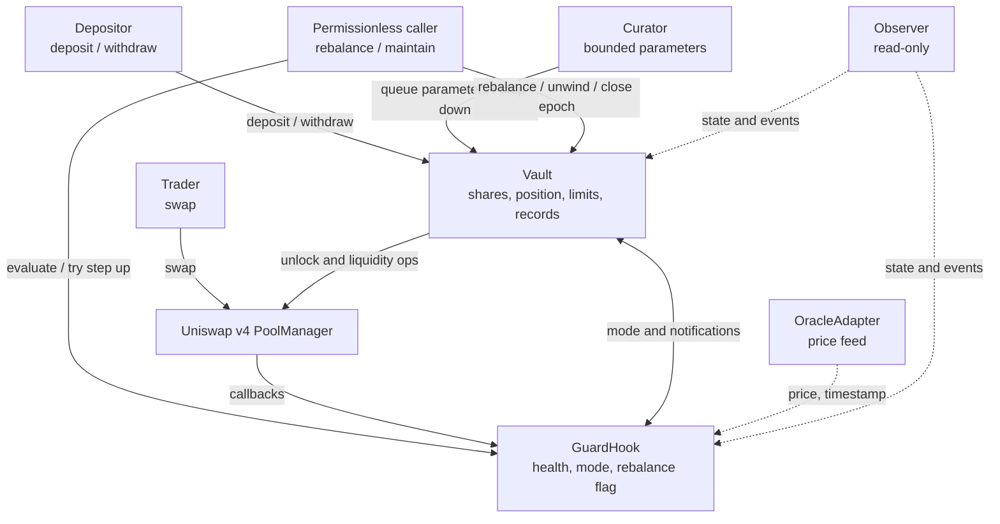
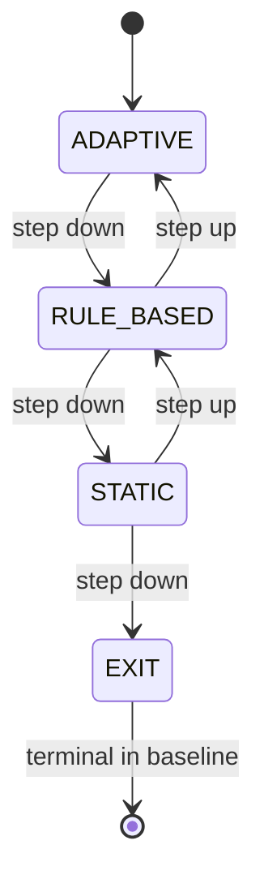

# Automated Liquidity Management System: Architecture

> **Status:** Draft, design baseline
> **Version:** 0.2
> **Scope:** Single-pool, Uniswap v4-based liquidity management
> **Primary contracts:** `GuardHook`, `Vault`
> **External protocol:** Uniswap v4 `PoolManager`

### Change log

| Version | Change |
|---|---|
| 0.1 | Initial baseline |
| 0.2 | One-time hook/vault linkage; terminal `EXIT`; label specification; drawdown ownership; rebalance skip pattern; single authoritative health parameters; hook-side range cache; explicit non-goals; corrected deployment section with mock oracle |

---

## 1. Purpose and scope

The system manages a concentrated liquidity position on behalf of vault depositors. It monitors pool and oracle conditions, steps down to more restrictive modes when conditions deteriorate, and lets any caller trigger bounded rebalances when the system is healthy.

- **`GuardHook`** is the risk and mode-control layer. It evaluates health, owns the operating mode, records the reason for each change, and tracks whether a rebalance is needed.
- **`Vault`** is the accounting and execution layer. It issues shares, manages the position, enforces curator bounds, executes rebalances, and records epochs.
- **Uniswap v4 `PoolManager`** executes swaps and liquidity operations and calls the hook.
- **`OracleAdapter`** is the price-data boundary.
- **Observer** is read-only.

### 1.1 Goals

1. Manage one configured v4 pool with one vault-owned strategy.
2. Keep depositor accounting separate from risk evaluation.
3. Support four modes: `ADAPTIVE`, `RULE_BASED`, `STATIC`, `EXIT`.
4. Step down when oracle or pool inputs become unreliable.
5. Keep withdrawals independent of the operating mode and of any oracle-priced swap.
6. Bound curator configuration and rebalance execution.
7. Record mode changes, rebalances, deposits, withdrawals and periodic snapshots.
8. Make the main safety properties testable as invariants.

### 1.2 Non-goals (baseline)

- Multi-pool or multi-chain management; multiple vaults per hook.
- Performance fees or any curator revenue mechanism.
- Upgradeability of either contract.
- A directional or dynamic fee (optional later; requires `beforeSwap`).
- An ERC-4626 interface (a wrapper may be added later without changing the core).
- Fee-on-transfer, rebasing or otherwise non-standard ERC-20s.
- A guaranteed execution price or MEV-free rebalancing.
- A production oracle provider or lending integration.
- A production-ready benchmark methodology.
- An audited or compile-verified implementation.

The example pair is USDC/USDT. The final pair and pool configuration are not yet confirmed.

---

## 2. Architecture at a glance

### 2.1 Logical components



The diagram is logical, not a call trace. Exact v4 callback signatures, permission flags, unlock flow and state-library APIs must be checked against the pinned v4 version.

### 2.2 Architectural style

- **Separation of concerns:** risk in the hook, accounting and execution in the vault.
- **Callback-driven observation:** swaps notify the hook.
- **Permissionless maintenance:** callers trigger eligible operations but never choose ranges or swap amounts.
- **Fail-degraded:** unhealthy inputs reduce what the strategy may do.
- **Read-only observability:** monitoring clients cannot influence decisions.

### 2.3 Trust boundaries

| Boundary | Assumption | Treatment |
|---|---|---|
| Oracle feed | May be stale, invalid, unavailable or manipulated | Validate timestamp, positive price and deviation; isolate failed calls |
| Pool spot price | Can be moved within a block | Bound tick movement; cross-check against the oracle in `ADAPTIVE` |
| Curator | Authorised but not trusted with unrestricted control | Immutable bounds and timelock; no custody permissions |
| Rebalance caller | Fully untrusted | Caller supplies no range or swap input |
| ERC-20 tokens | Standard behaviour assumed | Safe transfer wrappers; reject unsupported tokens at deployment |
| Observer / frontend | Read-only, possibly stale | Never an input to authorisation or execution |
| PoolManager callbacks | Protocol-controlled, version-specific | Authenticate the caller; request only needed permissions |

---

# Part I: High-level design

## 3. Actors and permissions

| Actor | Can | Cannot |
|---|---|---|
| Depositor | Deposit both assets (normal modes only), withdraw in every mode | Change parameters or mode |
| Curator | Queue bounded parameter changes; step the mode down | Withdraw funds, step the mode up, exceed bounds, run arbitrary calls |
| Caller | `rebalance()`, `unwind()`, `evaluate()`, `tryStepUp()`, `closeEpoch()` when preconditions hold | Set ranges, choose swap amounts, change parameters |
| Trader | Swap in the pool | Access vault accounting |
| Observer | Read state and events | Mutate state |
| Deployer | Call `setVault()` once at deployment | Anything after linkage |

## 4. Component responsibilities

### 4.1 GuardHook

**Owns:** operating mode; the single authoritative `HealthParams`; last observed tick and check block; last mode change time and reason; healthy streak; step-down counter; `needsRebalance`; a cached copy of the vault's range edges and last-rebalance block.

**Responsibilities:**
1. Receive the configured v4 callbacks.
2. Read the current tick and run inexpensive health checks at swap time.
3. Step down on a defined failure and record the reason.
4. Flag when the position is near a range edge.
5. Expose `mode()`, `describe()` and the health state.
6. Allow permissionless full evaluation and guarded step-up.
7. Restrict liquidity additions to the vault.

It does not calculate shares or move depositor assets.

### 4.2 Vault

**Owns:** share accounting (the vault is the ERC-20 share token); the liquidity position and range; internally accounted idle balances; curator address, bounds and queued parameters; rebalance timing; epoch records and benchmark snapshots; a high-water share price for drawdown.

**Responsibilities:**
1. Accept deposits only in `ADAPTIVE` and `RULE_BASED`.
2. Mint shares proportionally without an oracle.
3. Allow in-kind withdrawals in every mode.
4. Run liquidity removal, an optional bounded inventory swap and liquidity addition through the PoolManager unlock flow.
5. Enforce range, movement, swap-size and timing limits.
6. Apply curator parameters after bounds and timelock checks, and push health parameters to the hook.
7. Notify the hook after each rebalance.
8. Record epochs, benchmarks and drawdown.
9. Pay caller credit from collected fees only, within a cap.

### 4.3 PoolManager

External. It executes pool operations and calls the hook. The vault must settle token deltas correctly within the PoolManager's accounting model.

### 4.4 OracleAdapter

Returns a normalised `(price, updatedAt)`. The adapter is not a source of trust: the hook validates every result and handles failed reads. A controllable mock is used in tests and on testnets.

### 4.5 Observer

Reads mode, last reason, health parameters, position, idle balances, share views, epoch records and events. Its display is a view of on-chain state, not an independent source of truth.

---

## 5. Operating modes and state machine

### 5.1 Modes

| Mode | Rebalance | Deposits | Withdrawals | Inputs required |
|---|---|---|---|---|
| `ADAPTIVE` | After full health validation | Yes | Yes | Validated oracle and pool state |
| `RULE_BASED` | Pool-only rules, tightly capped movement | Yes | Yes | Pool state |
| `STATIC` | No | No | Yes | None |
| `EXIT` | No; `unwind()` available | No | Yes | None |

`EXIT` is an unwind and withdrawal state. It is not a promise that assets can be transferred under every possible token or PoolManager failure.

### 5.2 Transitions



- **Step down** has three triggers: an automatic health failure, a drawdown breach, or a curator request. A severe failure may skip a rung only if the severity table says so explicitly.
- **Step up** goes up exactly one rung, is permissionless to request, and needs all of: the configured healthy streak, the cooldown, and a fresh full evaluation that passes. The curator has no step-up power.
- **`EXIT` is terminal for this vault instance.** Recovery means migrating to a new deployment, which is out of scope.

### 5.3 Health conditions

| Reason code | Condition | Response |
|---|---|---|
| `POOL_JUMP` | Tick movement exceeds `maxJumpTicks` | Step down per severity table |
| `ORACLE_FAIL` | Adapter read reverts or cannot be decoded | Step down from `ADAPTIVE` |
| `ORACLE_INVALID` | Price is zero or negative, or `updatedAt` is in the future | Step down from `ADAPTIVE` |
| `ORACLE_STALE` | `block.timestamp - updatedAt > maxOracleAge` | Step down from `ADAPTIVE` |
| `DEVIATION` | Normalised pool price differs from the oracle by more than `maxDeviationBps` | Step down from `ADAPTIVE` |
| `NO_REBALANCE` | No rebalance for `noRebalanceBlocks` while the position is out of range | Step down per policy |
| `DRAWDOWN` | Reported by the vault at epoch close | Step down one rung |

Reason codes are stable `bytes32` constants. The order of checks and the severity table are implementation specifications.

### 5.4 Step-up counting

`healthyStreak` counts **distinct blocks** with a passing evaluation, not swap callbacks. Multiple swaps in one block add at most one.

### 5.5 Drawdown ownership

1. The vault computes `drawdownBps` at `closeEpoch()` as the fall from its high-water share price.
2. It does so **only when the epoch is oracle-valued**. A drawdown measured on a manipulable pool price must not be able to force a step-down.
3. If `drawdownBps > maxDrawdownBps`, the vault calls `hook.reportDrawdownBreach()`, which is restricted to the vault and steps down one rung with reason `DRAWDOWN`.

---

## 6. Main flows

### 6.1 Deposit

1. Caller invokes `Vault.deposit(amount0, amount1, receiver)`.
2. Reverts `DepositsClosed` unless mode is `ADAPTIVE` or `RULE_BASED`.
3. Vault computes accounted holdings: position amounts at the current price plus internal idle balances.
4. Vault mints the proportional shares, takes only the matching amounts, and refunds the excess.
5. Vault adds the assets to the strategy and emits `Deposited`.

The calculation is proportional and uses no oracle. The first-deposit path, rounding and refund behaviour are specified in section 9.4.

### 6.2 Swap and monitoring

1. A trader swaps through the PoolManager.
2. `GuardHook.afterSwap` reads the current tick.
3. It runs the bounded swap-time checks: tick jump, cached overdue-rebalance check, and range edge. It uses no vault read.
4. On failure it records the reason and steps down.
5. If the tick is near a range edge, it sets `needsRebalance`.
6. It returns the callback selector.

**Availability goal:** `afterSwap` should avoid avoidable reverts. Keep it bounded, isolate external reads, and do no vault execution inside it. This is an engineering objective, not an unconditional guarantee.

**Oracle checks at swap time:** a full oracle read on every swap costs gas. The baseline runs the oracle checks inside `evaluate()` and `rebalance()`, with an optional every-N-blocks check in the callback (see open decision D-04). Because `afterSwap` only runs on swaps, a stale oracle in a quiet pool is caught by the permissionless `evaluate()`.

### 6.3 Rebalance

1. Anyone calls `Vault.rebalance()`.
2. **Reverts, with no state change needed:** wrong mode (`STATIC`, `EXIT`), or `TooSoon`.
3. Vault calls `hook.evaluate()`, which runs the full checks and may step down.
4. **If unhealthy or no longer eligible:** the vault emits `RebalanceSkipped(reason)` and **returns without reverting**, so the step-down persists. A revert would roll the step-down back.
5. Vault computes the target range centred on the current tick, aligned to tick spacing.
6. In `RULE_BASED`, it requires the centre move to be within `maxMoveTicks`.
7. Vault enters the PoolManager unlock flow:
   - remove current liquidity and account for proceeds and fees;
   - compute the target token ratio;
   - if needed, swap a bounded portion of surplus inventory, within a price limit and `maxSwapSize`;
   - add liquidity at the new range; unused amounts become idle.
8. Vault pays caller credit from collected fees only, up to a cap.
9. Vault calls `hook.notifyRebalanced(tickLower, tickUpper)`, which updates the hook's cached range and last-rebalance block and clears `needsRebalance`.
10. Vault emits `Rebalanced`.

**MEV note:** the inventory swap can be front-run or sandwiched. The baseline controls (price limit, size cap, oracle validation in `ADAPTIVE`) reduce exposure and do not eliminate it. This is open decision D-01 and will be refined during implementation.

### 6.4 Withdraw

1. Depositor calls `Vault.withdraw(shares, receiver)`.
2. Vault burns the shares first.
3. Vault computes the proportional liquidity and idle balances.
4. Vault removes the corresponding liquidity through the PoolManager if needed.
5. Vault transfers both assets in kind and emits `Withdrawn`.

Withdrawals are not gated by mode and use no oracle-priced swap. External token or PoolManager failures remain outside the vault's control.

### 6.5 Unwind

In `EXIT`, anyone may call `unwind()` to remove all remaining liquidity into idle balances. Depositors then withdraw pro rata in kind. Repeat-call behaviour, partial failure and outstanding fees are implementation specifications.

### 6.6 Epoch close

1. Anyone calls `closeEpoch()` after the minimum interval.
2. Vault computes share price using the documented valuation method and sets `oracleValued`.
3. Vault computes drawdown (oracle-valued epochs only) and reports a breach if needed.
4. Vault reads each benchmark in isolation. An unavailable value is flagged unavailable, never treated as zero.
5. Vault writes the record to a fixed-size ring buffer and emits `EpochClosed`.

### 6.7 Parameter update

1. Curator queues a parameter set (rebalance parameters and health parameters).
2. Vault checks every value against the immutable bounds.
3. Vault stores the queue with its earliest application time and emits `ParamsQueued`.
4. After the timelock, anyone may call `applyParams()`.
5. Vault applies the rebalance parameters, calls `hook.setHealthParams()` (restricted to the vault) and emits `ParamsApplied`.

---

## 7. Data and valuation

### 7.1 Asset accounting

The vault tracks position amounts, `idle0` and `idle1`, total shares, and fees collected or reserved for caller credit. `idle0` and `idle1` are internal accounting values. They are not substitutes for `balanceOf`, so donations cannot change the share price.

### 7.2 Share pricing and valuation

Deposits and withdrawals are proportional and oracle-free. Reporting uses a separate valuation:

- **Numeraire:** token1 (proposed).
- **Source:** the oracle when healthy, otherwise pool price with `oracleValued = false`.
- **Decimals:** normalised explicitly.
- **Fees:** whether uncollected pool fees count toward value is a documented choice (D-07).

Valuation affects records and drawdown only. It never affects deposits or withdrawals.

### 7.3 Benchmarks

| Benchmark | Method | Oracle needed |
|---|---|---|
| Passive LP | Shadow position with a fixed range from deployment; amounts from reserve formulas, fees from fee-growth for that range | No |
| HODL | Initial token amounts valued at the current valuation price | Yes |
| Lending | ERC-4626 `convertToAssets`, read in isolation | No |

Benchmarks are informational. They must use the same starting capital and a documented valuation timestamp and price convention. Verify the `StateLibrary` calls for the passive-LP fee estimate against the pinned version.

---

## 8. Label specification

The label is what depositors and observers read to see what the system is assuming. It is exposed by `GuardHook.describe()`, with curator terms read from the vault.

```solidity
struct Label {
    // live state (computed from storage)
    Mode    mode;
    bytes32 lastReason;
    uint64  lastModeChange;
    uint16  stepDownsTotal;
    bool    needsRebalance;
    uint64  lastRebalanceBlock;
    // dependencies and thresholds (from storage)
    address oracle;
    uint32  maxOracleAge;
    uint16  maxDeviationBps;
    uint24  maxJumpTicks;
    uint32  noRebalanceBlocks;
    // curator terms (from the vault)
    address curator;
    uint32  timelock;
    // structural properties (constants verified by tests)
    bool    curatorCanMoveFunds;  // false
    bool    upgradeable;          // false
    bool    exitAlwaysInKind;     // true
    // record
    uint64  epochCount;
}
```

**Rules:**
1. Compute every live field from storage. Do not duplicate them in a separate variable.
2. The structural properties are **constants, not measurements**. They describe how the contracts are written, and the label cannot prove them. Tests must assert each one (for example, no code path transfers principal to the curator). State this in user-facing documentation.
3. The label describes what the code does. It does not prove the code is safe.
4. Each `ModeChanged` event carries `(from, to, reason)`, so a dashboard can reconstruct history from events alone.

---

# Part II: Low-level design

## 9. Implementation design

### 9.1 Proposed layout

```text
src/
  GuardHook.sol
  Vault.sol
  interfaces/   IOracleAdapter.sol, IGuardHook.sol, IVaultView.sol, IBenchmark.sol
  libs/         Modes.sol, RangeMath.sol, ShareMath.sol, PriceMath.sol
  adapters/     OracleAdapter.sol
  benchmarks/   ERC4626Benchmark.sol, PassiveLpBenchmark.sol, HodlBenchmark.sol
test/
  mocks/        MockToken.sol, MockOracleAdapter.sol, MockLendingVault.sol
  unit/  invariants/  attacks/
script/
  01_DeployHook.s.sol  02_CreatePool.s.sol  03_DeployVault.s.sol
  04_LinkVault.s.sol   05_Smoke.s.sol      06_Demo.s.sol
```

This is a proposal. Add optional files only when the implementation needs them.

### 9.2 Shared types

```solidity
enum Mode { ADAPTIVE, RULE_BASED, STATIC, EXIT }   // order is part of stored state; do not reorder

struct HealthParams {
    uint32 maxOracleAge;           // seconds
    uint16 maxDeviationBps;
    uint24 maxJumpTicks;
    uint32 noRebalanceBlocks;
    uint16 healthyBlocksToStepUp;  // distinct passing blocks
    uint32 stepUpCooldown;         // seconds
    uint16 edgeMarginBps;          // share of range width that counts as "near the edge"
    uint16 maxDrawdownBps;
}

struct Position { int24 tickLower; int24 tickUpper; uint128 liquidity; }

struct EpochRecord {
    uint64  epoch;
    uint64  blockNumber;
    uint256 sharePrice;       // token1 numeraire; precision documented in code
    uint256 feesEarned;
    uint16  drawdownBps;
    Mode    mode;
    uint16  stepDownsTotal;
    uint256 passiveLp;
    uint256 hodl;
    uint256 lending;
    bool    oracleValued;
    bool    lendingAvailable;
}
```

Position identity: a v4 position is keyed by owner, tick range and salt. The vault is the owner. Confirm the exact keying and the partial-removal behaviour against the pinned version.

### 9.3 GuardHook

**State:**

```solidity
Mode    public mode;
uint64  public lastModeChange;
bytes32 public lastReason;
int24   public lastTick;
bool    public tickInitialised;
uint64  public lastCheckBlock;
uint16  public stepDownsTotal;
bool    public needsRebalance;
uint16  public healthyStreak;
uint64  public lastHealthyBlock;

HealthParams public healthParams;           // the single authoritative copy

// cached from the vault, pushed by notifyRebalanced()
int24   public rangeLower;
int24   public rangeUpper;
uint64  public lastRebalanceBlock;

IPoolManager  public immutable poolManager;
IOracleAdapter public immutable oracle;
address public immutable deployer;          // may call setVault() once
address public vault;                       // set once; zero until linked
```

**Restricted functions (vault only):** `setHealthParams`, `notifyRebalanced`, `reportDrawdownBreach`.
**Deployer only, once:** `setVault`.
**Permissionless:** `evaluate`, `tryStepUp`.
**Curator, via the vault:** `curatorStepDown` (the hook checks the caller is the vault, and the vault checks the curator).

If `mode` is a public variable, Solidity generates `mode()`. Do not declare a second function with the same name.

**Permissions requested:**

| Callback | Use |
|---|---|
| `afterSwap` | Tick observation, swap-time checks, step-down, rebalance flag |
| `beforeAddLiquidity` | Allow only the vault to add liquidity |
| `afterInitialize` | Optional; initial tick |
| `beforeSwap` | Only if a dynamic or directional fee is added later |
| `beforeRemoveLiquidity` | Omit; nothing should block removal |

Permissions are encoded in the hook's address in v4, so the set must be final before deployment and the address mined accordingly.

**`beforeAddLiquidity`:** require `sender == vault`. Confirm that `sender` is the account that called the PoolManager's liquidity function. The vault calls it from its unlock callback, so it should be the vault. Verify against the pinned version.

**`afterSwap` (conceptual):**

```solidity
function _afterSwap(address, PoolKey calldata key, SwapParams calldata, BalanceDelta, bytes calldata)
    internal override returns (bytes4, int128)
{
    int24 tick = _readTick(key);
    bytes32 reason = _swapTimeChecks(tick);        // no vault reads, no unbounded work
    if (reason != 0) _stepDown(reason);
    else _recordHealthyBlock();
    lastTick = tick; tickInitialised = true; lastCheckBlock = uint64(block.number);
    if (_nearEdge(tick)) needsRebalance = true;
    return (BaseHook.afterSwap.selector, 0);
}
```

Handle the uninitialised `lastTick` case, isolate external reads, and use the callback signature of the pinned version.

**Full evaluation (`evaluate()` and `rebalance()` path):**

```text
POOL_JUMP        if tickInitialised and |tick - lastTick| > maxJumpTicks
ORACLE_FAIL      if the adapter call fails
ORACLE_INVALID   if price <= 0 or updatedAt > block.timestamp
ORACLE_STALE     if block.timestamp - updatedAt > maxOracleAge
DEVIATION        if |poolPrice - oraclePrice| / oraclePrice > maxDeviationBps
NO_REBALANCE     if block.number - lastRebalanceBlock > noRebalanceBlocks and tick outside [rangeLower, rangeUpper]
```

Normalise token decimals and token0/token1 order before any price comparison. Comparing raw oracle units with a raw pool price is unsafe.

**Mode controller:**
- `_stepDown(reason)`: no-op in `EXIT`; otherwise move down per the transition table, update `mode`, `lastModeChange`, `lastReason`, reset `healthyStreak`, increment `stepDownsTotal`, emit `ModeChanged`.
- `tryStepUp()`: reject in `ADAPTIVE` and `EXIT`; check streak, cooldown and a fresh full evaluation; move up one rung; emit `ModeChanged`.
- `curatorStepDown(target)`: vault-only; target must be strictly more restrictive. Use an explicit transition table, not only enum ordering.

### 9.4 Vault

**State:**

```solidity
Position public pos;
uint256 public idle0;
uint256 public idle1;
uint64  public lastRebalance;
uint256 public highWaterSharePrice;

Params  public params;
Bounds  public immutable bounds;
address public immutable curator;
IGuardHook public immutable hook;
IPoolManager public immutable poolManager;
```

Additional state: share token storage, pool key and ID, token addresses, epoch ring buffer, queued parameters.

**Share calculation:**

```text
shares0 = D0 * S / A0
shares1 = D1 * S / A1
shares  = min(shares0, shares1)
```

where `A0`, `A1` are total accounted holdings, `D0`, `D1` the supplied amounts and `S` the share supply. Take only the matching amounts and refund the excess.

- **First deposit** (`S == 0`): use a separately specified initial mint and permanently lock a minimum number of shares to an irrecoverable address.
- **Rounding:** against the depositor on deposit, against the vault on withdrawal. Never over-mint.
- **Precision:** use full-precision multiply-divide.
- **Position amounts:** use the correct v4 liquidity math at the current price.
- **Updates:** update idle accounting on every deposit, withdrawal, rebalance, fee collection and unwind.

**Withdrawal:**

```text
liquidityToRemove = pos.liquidity * sharesToBurn / S
idle0Out          = idle0 * sharesToBurn / S
idle1Out          = idle1 * sharesToBurn / S
```

Burn shares and update accounting before external transfers; use reentrancy protection and safe transfers.

**Rebalance bounds:** `minInterval` (blocks or time, name the unit), `rangeWidthTicks`, `maxMoveTicks`, `maxSwapSize`, `sqrtPriceLimitX96`, `creditBps`, `creditCap`. Caller credit comes from collected fees, never from principal.

**Unlock and settlement checklist (document before coding):** which contract calls `unlock`; how the callback authenticates the PoolManager; how liquidity deltas are computed and settled; how fees are collected; how reentrancy is prevented across the callback.

### 9.5 Oracle and benchmark interfaces

```solidity
interface IOracleAdapter {
    function latest() external view returns (int256 price, uint256 updatedAt);
}
```

Document the price scale and quote direction. All consumers must use the same units.

```solidity
interface IBenchmark {
    function value(/* documented snapshot inputs */) external view returns (uint256 value, bool available);
}
```

A failed benchmark read sets the matching availability flag and never blocks withdrawals or other epoch data.

### 9.6 Events and errors

```solidity
event ModeChanged(Mode indexed from, Mode indexed to, bytes32 reason);
event Rebalanced(int24 tickLower, int24 tickUpper, uint256 fees, address caller);
event RebalanceSkipped(bytes32 reason);
event Deposited(address indexed caller, address indexed receiver, uint256 amount0, uint256 amount1, uint256 shares);
event Withdrawn(address indexed owner, address indexed receiver, uint256 shares, uint256 amount0, uint256 amount1);
event EpochClosed(uint64 indexed epoch, uint64 blockNumber, bool oracleValued);
event ParamsQueued(uint64 eta);
event ParamsApplied();
event VaultLinked(address vault);

error NotCurator(); error NotVault(); error NotDeployer();
error OutOfBounds(); error DepositsClosed(); error NotAllowedInMode();
error TooSoon(); error TimelockPending(); error InvalidModeTransition();
error AlreadyLinked(); error InvalidLink();
error InvalidAmount(); error InsufficientShares();
error InvalidPool(); error UnauthorizedCallback();
```

Finalise event fields before implementation.

---

# Part III: Security and verification

## 10. Security design

### 10.1 Access control

- Only the curator can queue parameters or request a step-down.
- The curator has no transfer or arbitrary-call function.
- Only the vault can call `setHealthParams`, `notifyRebalanced` and `reportDrawdownBreach`.
- PoolManager callbacks authenticate the PoolManager.
- Permissionless functions compute their own parameters.
- **Health thresholds are safety-critical.** A curator who loosens `maxOracleAge` or `maxDeviationBps` could keep the vault in `ADAPTIVE` on bad data. Bound these parameters tightly (immutable min and max), and route every change through the timelock.

### 10.2 Reentrancy and external calls

Protect deposit, withdraw and rebalance. A standard `nonReentrant` modifier can interact badly with nested unlock callbacks, so design the lock to fit the PoolManager's execution model. Use checks-effects-interactions and safe ERC-20 wrappers.

### 10.3 Oracle safety

Validate a positive price, a non-future timestamp and a maximum age. Normalise decimals and direction. Treat a failed read as unhealthy, never as zero or a valid fallback. Do not use an unvalidated oracle price for withdrawal amounts.

### 10.4 Pool-price and MEV safety (baseline)

Bound tick jumps, `RULE_BASED` movement, inventory swap size and price. Validate the oracle before adaptive execution. These controls reduce manipulation and MEV exposure and do not remove it. See D-01.

### 10.5 Share-accounting safety

Use a first-deposit defence, internal idle accounting, full-precision math and conservative rounding. Test tiny amounts and extreme supplies. Every asset movement needs a matching accounting update.

### 10.6 Failure containment

Oracle failure degrades the mode. A lending-benchmark failure is flagged and does not block epoch recording. A failed rebalance must not corrupt position or idle accounting. Keep the hook callback small and defensive because its failure can revert a trader's swap.

## 11. Invariants and tests

| ID | Property | Test |
|---|---|---|
| INV-01 | Mode alone never blocks an in-kind withdrawal | Withdraw in all four modes |
| INV-02 | Curator cannot receive principal | Unauthorised transfer and call tests |
| INV-03 | Donations cannot inflate the share price | Donation and inflation attack |
| INV-04 | Every transition emits `ModeChanged` with a defined reason | Event and transition-table tests |
| INV-05 | Step-up needs streak, cooldown and fresh evaluation | Boundary tests |
| INV-06 | Caller credit never exceeds fees collected | Fuzz fees and caps |
| INV-07 | Oracle fail, stale, invalid or deviating data cannot authorise adaptive rebalance | Oracle adversarial tests |
| INV-08 | `RULE_BASED` movement never exceeds `maxMoveTicks` | Fuzz ticks |
| INV-09 | Swap never exceeds `maxSwapSize` or its price limit | Swap-bound tests |
| INV-10 | Deposits disabled in `STATIC` and `EXIT` | Mode access tests |
| INV-11 | Normal rebalance disabled in `STATIC` and `EXIT` | Mode access tests |
| INV-12 | Idle plus position accounting reconciles with managed assets, within documented rounding | Stateful invariant test |
| INV-13 | A failed benchmark read does not block epoch close | Mock revert test |
| INV-14 | Unlock callback rejects unauthorised callers | Callback authentication test |
| INV-15 | Rebalances respect the minimum interval | Boundary tests |
| INV-16 | `setVault` succeeds exactly once, only by the deployer, only for a matching vault | Linkage tests |
| INV-17 | A health failure inside `rebalance()` persists the step-down (no revert) | Rebalance skip test |
| INV-18 | A drawdown breach is only possible on an oracle-valued epoch | Epoch valuation test |
| INV-19 | `describe()` matches storage after every transition | Label consistency test |
| INV-20 | Structural label constants hold (no principal path to curator, not upgradeable) | Static and behavioural tests |

Cover unit, fuzz and adversarial cases: oracle reverts, zero price, future timestamp, stale data; same-block tick jumps; direct donations; caller attempts to influence the range or swap; sandwich-style movement around the inventory swap; unauthorised callbacks; reentrant token callbacks.

---

# Part IV: Deployment and operations

## 12. Deployment and linkage

### 12.1 Why a linkage step exists

The hook needs the vault's address (liquidity gating, restricted calls) and the vault needs the hook's address. Both cannot be immutable references to each other. The baseline resolves this with a **one-time `setVault()`** on the hook, called by the deployer. An alternative is to precompute the vault address with CREATE2 so the hook can store it as an immutable. The baseline avoids that for simplicity.

### 12.2 Sequence

1. **Pin versions** (Solidity, v4-core, v4-periphery, template) and fix the environment configuration.
2. **Deploy the oracle adapter:**
   - a real adapter on a fork or mainnet-like network;
   - `MockOracleAdapter` on testnets. It exposes owner-only `setPrice`, `setUpdatedAt` and `setRevert`.
3. **Mine and deploy `GuardHook`:** find a CREATE2 salt whose address bits match the permission set, then deploy with `(poolManager, oracle, deployer, healthParams)`. `vault` is zero.
4. **Create the pool:** sort the currencies, build the pool key with the hook address, and call `poolManager.initialize(key, sqrtPriceX96)`. Until the vault is linked, `beforeAddLiquidity` rejects every sender, so no outside liquidity can enter.
5. **Deploy `Vault`** with `(poolManager, key, hook, curator, bounds, params, benchmarks)`.
6. **Link:** the deployer calls `hook.setVault(vault)` once. The hook must:
   - revert `NotDeployer` for any other caller;
   - revert `AlreadyLinked` if `vault` is already set;
   - revert `InvalidLink` unless the vault reports this hook and this pool ID;
   - emit `VaultLinked(vault)`.

   After this call the deployer has no powers, and the hook has no owner.
7. **Verify** (checklist below).
8. **Smoke test** with small amounts on the target network.

### 12.3 Verification checklist

- Hook address bits equal the intended permission set.
- `pool key.hooks == hook`, and the currencies are sorted correctly.
- `hook.vault() == vault` and `vault.hook() == hook`.
- `setVault` reverts on a second call and from a non-deployer.
- Mode is `ADAPTIVE`; the oracle returns a fresh price.
- Curator, bounds and timelock match the intended values.
- The deployer address retains no privileged function.
- Token decimals and quote direction in the adapter match the pool.

### 12.4 Smoke and demo scripts

**`05_Smoke`:** deposit, swap, `evaluate`, `rebalance`, `closeEpoch`, withdraw.

**`06_Demo` (forced failure):**
1. Run the normal path and show `describe()` in `ADAPTIVE`.
2. Use the mock oracle to make the price stale, then call `evaluate()`. Show `ModeChanged(ORACLE_STALE)` and the mode in `RULE_BASED`.
3. Call `rebalance()` and show the pool-only rules and the movement cap.
4. Make the oracle revert. Show the next step-down.
5. Withdraw in the degraded mode and show both tokens returned.

State clearly in the demo that the oracle is a mock on the testnet.

### 12.5 Environment configuration

Keep network-specific values out of source: chain ID and RPC, `PoolManager`, token addresses and decimals, pool fee and tick spacing, hook address and permissions, oracle address and quote direction, curator, initial health parameters, immutable bounds, lending benchmark address. Do not deploy with placeholder addresses or unverified token ordering.

### 12.6 Monitoring

Watch `ModeChanged` and its reason, `needsRebalance` and time since the last rebalance, oracle freshness and deviation, rebalance success and skips, total assets and share supply, idle balances, epoch records and benchmark availability, and parameter queue events. Monitoring can alert operators. The contracts remain responsible for enforcing every safety check.

---

# Part V: Open decisions

## 13. Decisions required

| ID | Priority | Decision | Status |
|---|---|---|---|
| D-01 | Critical | Rebalance inventory-swap limits and execution policy (MEV) | Open; baseline controls only; will be refined while coding |
| D-02 | Critical | Final token pair, fee tier and range width | Stable/stable proposed |
| D-03 | Critical | Pinned v4 version, and the position ownership and unlock mechanics | Open |
| D-04 | High | How often the oracle is read at swap time (every swap, every N blocks, or `evaluate()` only) | Baseline: `evaluate()` and `rebalance()` |
| D-05 | High | Step-down severity table | Partially specified |
| D-06 | High | Timelock length and health-parameter bounds | Open |
| D-07 | Medium | Valuation convention (numeraire, uncollected fees, precision) | Proposed |
| D-08 | Medium | Benchmark methodology and ring-buffer size | Partially specified |
| D-09 | Medium | Maximum drawdown threshold and whether repeated breaches escalate to `EXIT` | Open |
| D-10 | Low | Optional directional fee | Omitted by default |

## 14. Recommended implementation order

1. Lock versions and pool assumptions.
2. Implement shared types, interfaces, errors and events.
3. Implement and test the `GuardHook` mode controller with mocked inputs.
4. Implement vault accounting without rebalance: first deposit, proportional deposits, withdrawals, idle accounting, donation resistance.
5. Integrate PoolManager position operations: unlock, authentication, deltas, settlement, fees.
6. Implement bounded rebalance and the hook linkage (`notifyRebalanced`, `setVault`).
7. Add epochs, drawdown and benchmarks.
8. Implement the label and its consistency tests.
9. Run invariant and adversarial tests, then fork tests against the pinned v4 version.
10. Deploy to a testnet with conservative limits and run the demo.

## 15. Caveats

This is a design specification. It is not audited Solidity, and the illustrative snippets are not guaranteed to compile. Verify every v4 API against the pinned version, in particular `BaseHook` signatures and permissions, `StateLibrary` accessors, the unlock and callback API, liquidity and fee-collection flows, position keying, and hook-address permission requirements. Obtain an independent security review before handling production funds.

## 16. Glossary

| Term | Meaning |
|---|---|
| Hook | Contract called by v4 at configured pool lifecycle points |
| PoolManager | v4 contract that manages pool state and executes swaps and liquidity operations |
| Vault | Contract that issues shares and manages the strategy position |
| Curator | Authorised parameter manager with bounded permissions |
| Rebalance | Moving the position to a new tick range, possibly swapping inventory |
| Tick | Discrete logarithmic price coordinate |
| Idle assets | Vault-held tokens outside the active position, tracked internally |
| Epoch | Periodic snapshot of share price, strategy state and benchmarks |
| Step-down / step-up | Move to a more or less restrictive mode |
| In-kind withdrawal | Returning both underlying tokens without swapping |
| MEV | Value captured by transaction ordering, such as sandwich attacks |

## Architecture

Keel stores a minimal on-chain epoch snapshot in the Vault: timestamp, share price,
whether the price was oracle-valued, and drawdown. Epochs are used to enforce
drawdown-based step-downs safely.

Performance against passive LP, HODL and lending benchmarks is computed off-chain by
the dashboard/indexer from on-chain events and state. This keeps gas costs low and
allows benchmark methodology to evolve without redeploying the contracts.